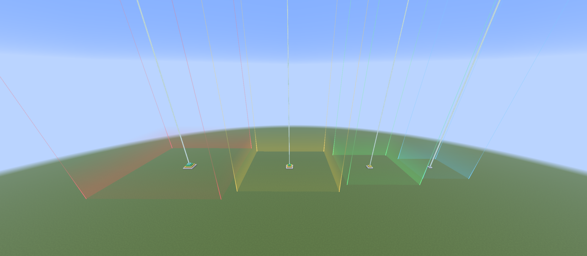
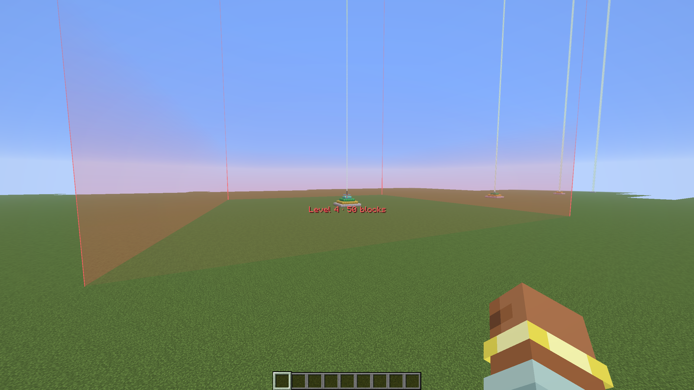
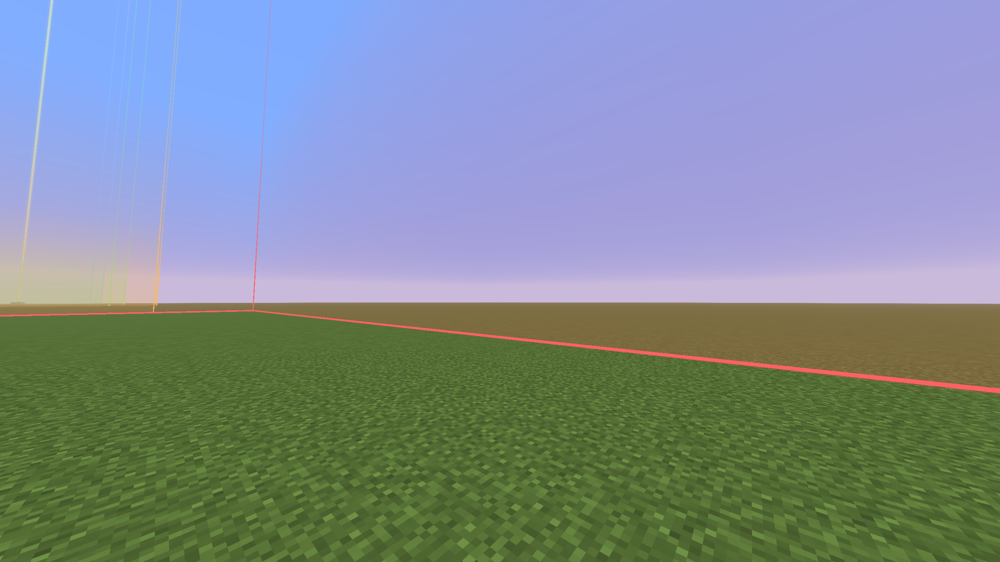
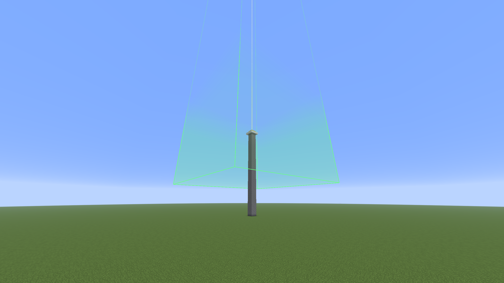
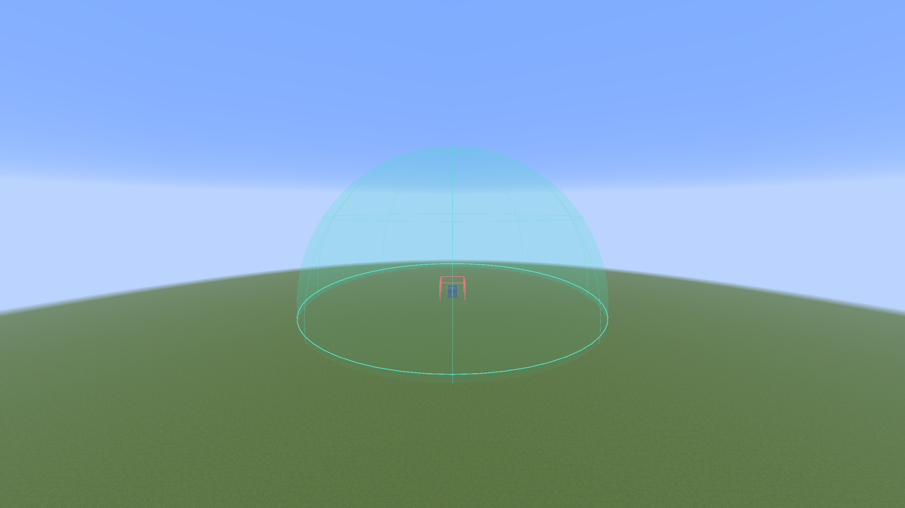
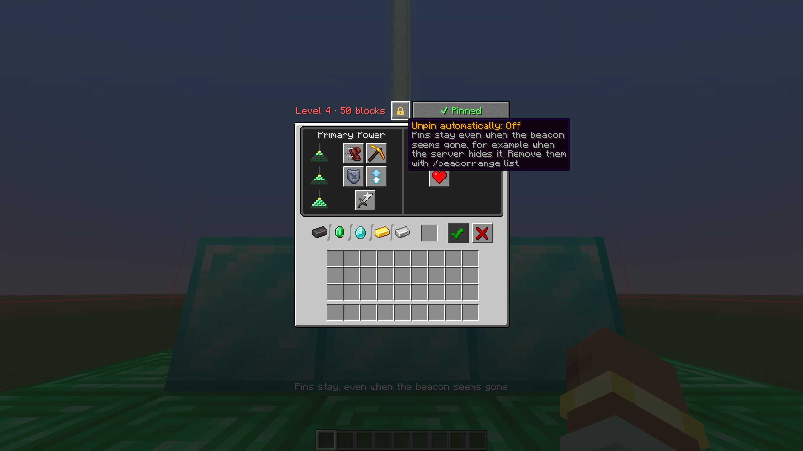
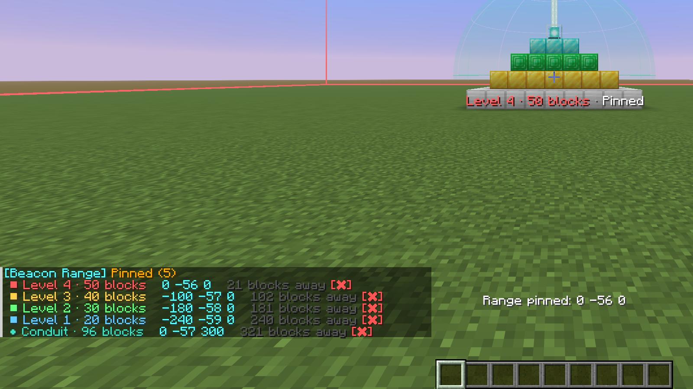
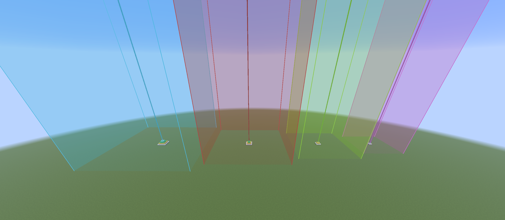
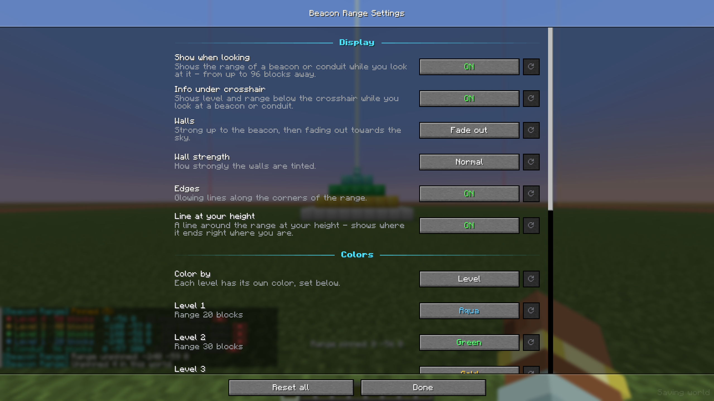

# Beacon Range

See exactly where the effects of a beacon - or a conduit - reach. Look at one and its range appears around it - pin it, and it stays visible while you build.

## Look at a beacon

Look at any active beacon - even from up to 96 blocks away - and its range appears:

- **Glowing edges** mark the corners of the range.
- **Walls** are strong up to the beacon and fade out towards the sky.
- **A line at your height** runs around the range, so you see where it ends right where you stand.
- **Level and range** show under your crosshair.

The color shows the level:

| Level | Range | Color |
| --- | --- | --- |
| 1 | 20 blocks | Aqua |
| 2 | 30 blocks | Green |
| 3 | 40 blocks | Gold |
| 4 | 50 blocks | Red |

The range matches Minecraft exactly: the effects reach 20 to 50 blocks to each side, just as far down, and **all the way up to the sky**. Your hitbox only has to touch the range.

Most beacons stand on the ground, so the part below them is hidden in the earth. Put one on a tower and you see the range end in mid-air below it:

## Conduits

Look at a conduit and its range appears as a **sphere** - players inside it get Conduit Power while they are in water or rain. The size depends on the frame:

| Frame blocks | Range |
| --- | --- |
| 16 - 20 | 32 blocks |
| 21 - 27 | 48 blocks |
| 28 - 34 | 64 blocks |
| 35 - 41 | 80 blocks |
| 42 (full) | 96 blocks |

With a full frame a **red box** shows where the conduit attacks hostile mobs (8 blocks around it). Under your crosshair you see the range and how many frame blocks are in place. Pin a conduit with `/beaconrange pin` or the pin key.

## Pin it

Open the beacon and click **Pin range**. The range stays visible when you look away or walk off, so you can plan your base around it. Next to the button you see the level and range.

- Pin as many beacons and conduits as you like and see where their ranges overlap.
- Pins are **saved per world and server** and stay pinned when you leave, change dimension or rejoin.
- They stay visible even when the chunk is not loaded.
- A beacon that is broken is unpinned automatically. On servers that hide blocks (anti-xray shows deepslate instead of your beacon), click the **lock** next to *Pin range* - then pins stay until you remove them yourself.

### Commands

| Command | What it does |
| --- | --- |
| `/beaconrange list` | Everything pinned in this dimension with level, coordinates and distance. Click the red ✖ to unpin one. Pins whose block is not there right now are marked. |
| `/beaconrange pin` | Pins (or unpins) the beacon or conduit you look at. |
| `/beaconrange remove x y z` | Unpins one (press Tab for suggestions). |
| `/beaconrange clear` | Unpins everything in this world. |

## Settings

Open the settings through [Mod Menu](https://modrinth.com/mod/modmenu):

- **Show when looking** and **Info under crosshair** on or off
- **Walls**: fade out, full height or off - and how strong they are
- **Edges** and the **line at your height** on or off
- **Colors**: pick a color for each level, or use the **beam color** - dye the beam with stained glass and the range follows
- **Conduits**: show their ranges, their color and the attack box
- **Unpin automatically** on or off (same as the lock button)

Under *Options > Controls > Key Binds > Beacon Range* you can bind keys to **pin the beacon or conduit you look at** (without opening it), **hide all ranges** and **open the settings**. They are unbound by default.

## Good to know

- Purely client-side: works on any server, nothing needs to be installed there.
- A short tour shows how it works the first time you start a profile with this mod. You can open it again under *Settings > Help*.
- For Minecraft 1.21.4 to 26.3.
- English and German.

Requires [Fabric API](https://modrinth.com/mod/fabric-api). Mod Menu is optional.
