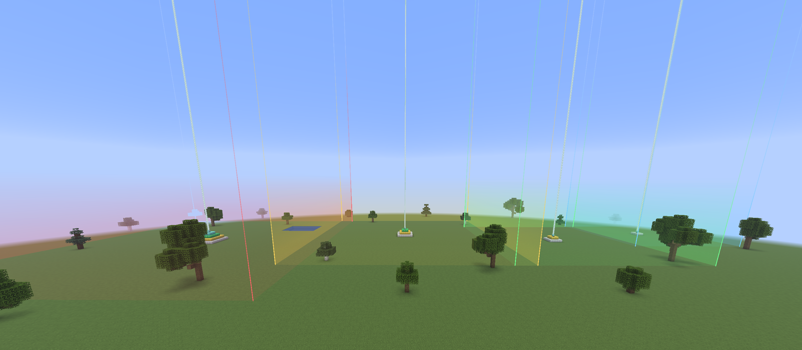
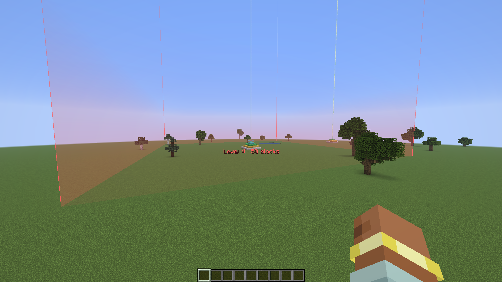
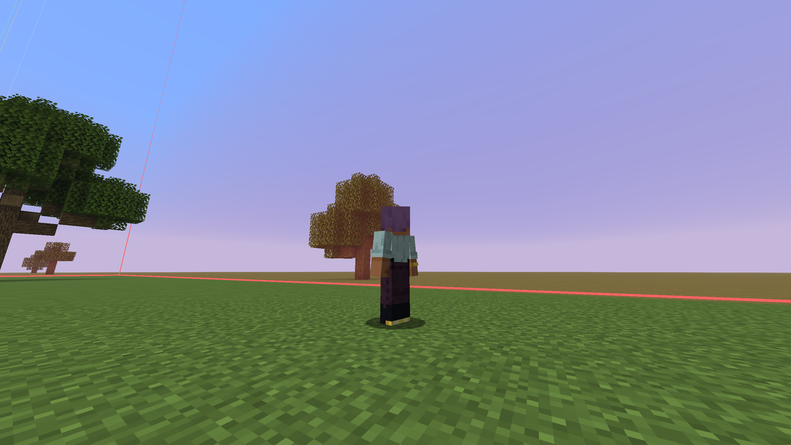
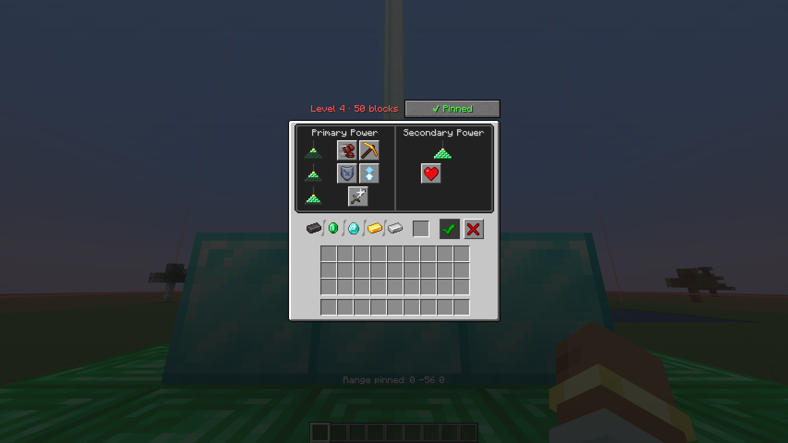
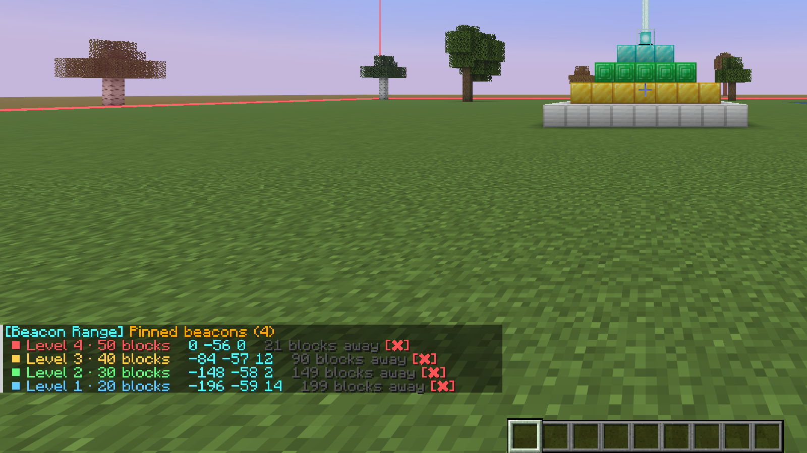
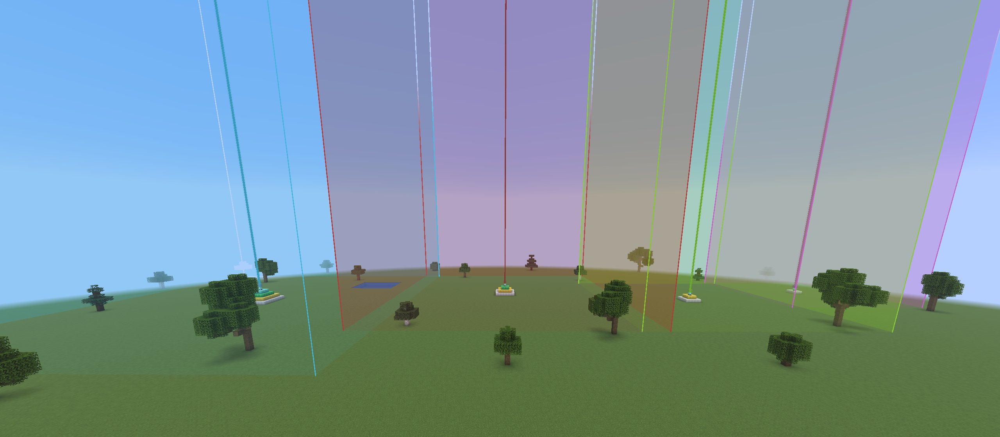
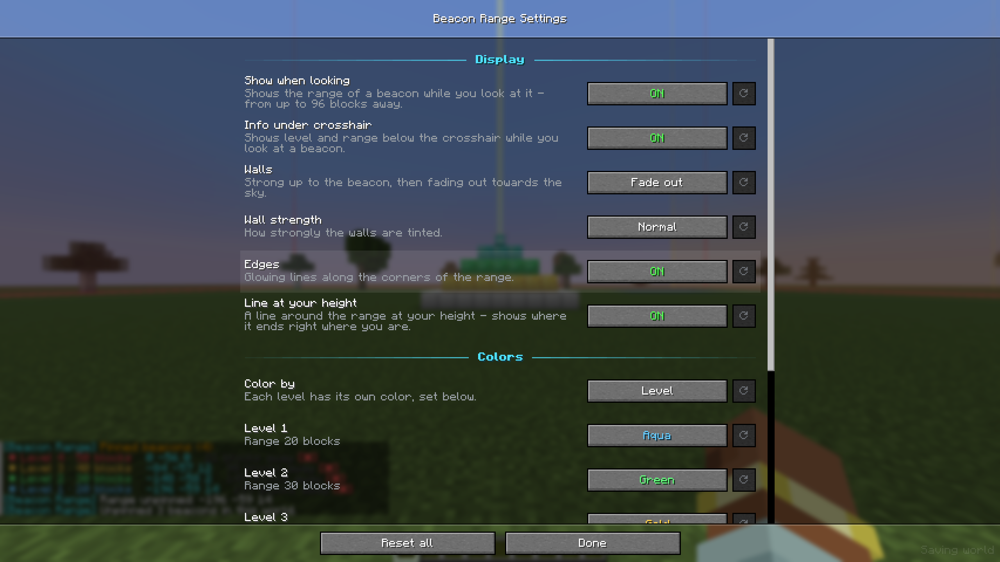

# Beacon Range

See exactly where the effects of a beacon reach. Look at a beacon and its range appears around it - pin it, and it stays visible while you build.

## Look at a beacon

Look at any active beacon - even from up to 96 blocks away - and its range appears:

- **Glowing edges** mark the corners of the range.
- **Walls** are strong up to the beacon and fade out towards the sky.
- **A line at your height** runs around the range, so you see where it ends right where you stand.
- **Level and range** show under your crosshair.

The color shows the level:

| Level | Range | Color |
| --- | --- | --- |
| 1 | 20 blocks | Aqua |
| 2 | 30 blocks | Green |
| 3 | 40 blocks | Gold |
| 4 | 50 blocks | Red |

The range matches Minecraft exactly: the effects reach 20 to 50 blocks to each side, just as far down, and **all the way up to the sky**. Your hitbox only has to touch the range.

## Pin it

Open the beacon and click **Pin range**. The range stays visible when you look away or walk off, so you can plan your base around it. Next to the button you see the level and range.

- Pin as many beacons as you like and see where their ranges overlap.
- Pinned beacons are **saved per world and server** and stay pinned when you leave, change dimension or rejoin.
- They stay visible even when the beacon's chunk is not loaded.
- A beacon that is broken is unpinned automatically.

### Commands

| Command | What it does |
| --- | --- |
| `/beaconrange list` | All pinned beacons in this dimension with level, coordinates and distance. Click the red ✖ to unpin one. |
| `/beaconrange remove x y z` | Unpins one beacon (press Tab for suggestions). |
| `/beaconrange clear` | Unpins all beacons in this world. |

## Settings

Open the settings through [Mod Menu](https://modrinth.com/mod/modmenu):

- **Show when looking** and **Info under crosshair** on or off
- **Walls**: fade out, full height or off - and how strong they are
- **Edges** and the **line at your height** on or off
- **Colors**: pick a color for each level, or use the **beam color** - dye the beam with stained glass and the range follows

Under *Options > Controls > Key Binds > Beacon Range* you can bind keys to **pin the beacon you look at** (without opening it), **hide all ranges** and **open the settings**. They are unbound by default.

## Good to know

- Purely client-side: works on any server, nothing needs to be installed there.
- A short tour shows how it works the first time you start a profile with this mod. You can open it again under *Settings > Help*.
- English and German.

Requires [Fabric API](https://modrinth.com/mod/fabric-api). Mod Menu is optional.
