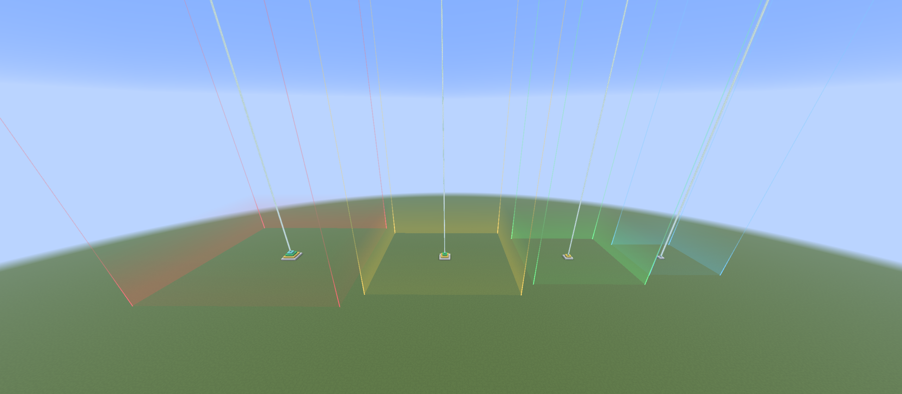

# Beacon Range

A client-side Fabric mod for Minecraft 1.21.11, 26.2 and 26.3 that shows exactly where the effects of a beacon - or a conduit - reach.



## Features

- **Look at a beacon** - even from up to 96 blocks away, or at its pyramid - to see its range: glowing edges, walls that fade out towards the sky and a line around the range at your height. Level and range show under your crosshair.
- **Exact range**: 20 / 30 / 40 / 50 blocks to each side for level 1 to 4, just as far down and all the way up to the sky - the same box Minecraft uses. A beacon with a blocked beam counts as inactive, like in Minecraft.
- **Conduits**: their range as a sphere (32 to 96 blocks, depending on the frame), and with a full frame the box where they attack mobs.
- **Pin** with the *Pin range* button in the beacon screen, `/beaconrange pin` or a key to keep the range visible. Pins are saved per world and server and survive unloaded chunks, dimension changes and rejoining.
- **Automatic unpinning** when a pinned beacon or conduit disappears while you are near it. The lock button next to *Pin range* turns it off for servers that hide blocks (anti-xray).
- **Colors** per level (aqua, green, gold, red by default) or the color of the beam; teal for conduits.
- **Settings** through [Mod Menu](https://modrinth.com/mod/modmenu): wall style and strength, edges, height line, crosshair info, colors, conduits, automatic unpinning.
- **Keys** (unbound by default): pin what you look at, hide all ranges, open the settings.
- English and German, welcome tour on first start.

## Commands

| Command | What it does |
| --- | --- |
| `/beaconrange list` | Everything pinned in this dimension with level, coordinates and distance; click ✖ to unpin. Pins whose block is not there right now are marked |
| `/beaconrange pin` | Pin or unpin the beacon or conduit you look at |
| `/beaconrange remove x y z` | Unpin one (Tab completes) |
| `/beaconrange clear` | Unpin everything in this world |

## Files

Settings and pins live in `config/KCMods/beaconrange/` (`config.json`, `pins.json`).

## Building

Each Minecraft version has its own folder and branch: `1.21.11` (branch `main`), `26.2` (branch `26.2`) and `26.3` (branch `26.3`).

```
./gradlew build                 # jar in build/libs
./gradlew runClientGameTest     # automated test in a real client; also saves the test world to run/saves/BeaconRangeTest
./gradlew runClient --args="--quickPlaySingleplayer BeaconRangeTest"   # play in that test world
```

Requires [Fabric API](https://modrinth.com/mod/fabric-api). MIT license.
